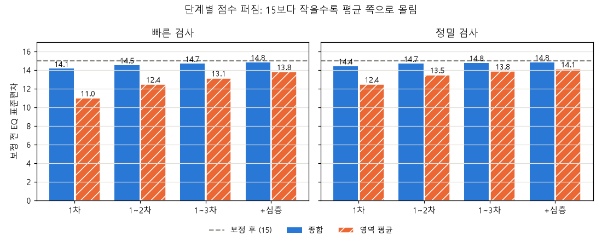

# 06. 검증 기록

8개 영역(관계 갈등 추가)·315문항 기준으로 다시 만든 수치입니다 (2026-10-12). 실제 응시자 데이터가 아직 없으므로 **수치는 모두 가상 응시자(능력을 미리 정해 둔 봇) 기준**입니다.

## 1. 봇 시뮬레이션 규준 (모드별 2만 명)

봇이 실제 출제 로직으로 1·2·3차와 심층검사를 모두 풀었습니다 (`scripts/build_sim_norms.py`).
"EQ 표준편차"는 보정 전 점수의 표준편차로, 15보다 작을수록 평균 쪽으로 몰린 것입니다.

| 모드 · 단계 | 종합 EQ 표준편차 | 영역 EQ 표준편차 | 참값과의 오차 (보정 전 → 후) | 90% 범위 적중률 |
|---|---|---|---|---|
| 빠른 · 1차 | 14.1 | 10.9 ~ 11.0 | ±5.1 → ±5.2 | 90.1% |
| 빠른 · 1~2차 | 14.5 | 12.4 ~ 12.5 | ±3.8 → ±3.9 | 90.4% |
| 빠른 · 1~3차 | 14.7 | 13.1 ~ 13.2 | ±3.2 → ±3.3 | 90.1% |
| 빠른 · +심층 | 14.8 | 13.6 ~ 13.8 | ±2.4 → ±2.5 | 90.2% |
| 정밀 · 1차 | 14.4 | 12.4 ~ 12.5 | ±3.8 → ±4.0 | 90.5% |
| 정밀 · 1~2차 | 14.7 | 13.4 ~ 13.5 | ±2.9 → ±3.0 | 90.3% |
| 정밀 · 1~3차 | 14.8 | 13.8 ~ 13.9 | ±2.4 → ±2.5 | 90.4% |
| 정밀 · +심층 | 14.8 | 13.9 ~ 14.1 | ±2.1 → ±2.2 | 90.0% |

- 90% 범위는 단계마다 배율(0.96~0.99)을 맞춰 실제로 90% 안팎을 맞힙니다.
- 차수를 더할수록 오차가 줄어 빠른 검사 기준 ±5.1점 → 심층검사까지 ±2.4점이 됩니다. 영역이 하나 늘어 7개 영역 때보다 조금씩 줄었습니다.

## 2. 가상 응시 600명 (관리자 분석 확인용, `scripts/simulate.py`)

| 확인 | 결과 |
|---|---|
| 일부러 난이도를 크게 틀어 놓은 문항 12개 | 응답 30개 이상인 **11개 모두** '예상보다 쉬움/어려움'으로 탐지 (나머지 1개는 데이터 부족) |
| 정답 키 오류를 흉내 낸 문항 6개 | 응답 30개 이상인 **5개 모두** '다수 응답과 정답 불일치'로 탐지 |
| 그 밖에 경고된 문항 | 22개 (봇이 모든 문항 난이도를 ±0.3씩 흔들어 둔 영향. 대부분 '예상보다 쉬움') |
| 종합 주변 신뢰도 | **0.90** |
| 영역 주변 신뢰도 | 0.56 ~ 0.60 (빠른·정밀·심층이 섞인 값. 영역 점수를 참고용으로 표시하는 근거) |
| 1·2차 동형 검사 신뢰도 | 0.89 (253명) |
| 심층검사 영역별 문항 수 / 최종 오차 | 4.8 ~ 5.2문항 / ±5.2 ~ 5.6점 |

자기평가 α는 봇이 문항마다 독립적으로 답하게 만든 탓에 영역별로 낮게(0.31~0.44) 나왔습니다.
실제 사람 응답에서 다시 확인해야 하는 수치입니다 (점검 문항을 뺀 전체 32문항 α는 0.83).

## 3. 검사지 구성 점검

| 점검 | 결과 |
|---|---|
| 구성표 규칙 (`validate_blueprint`) | 위반 0건 |
| 문항 형식·중복 상황·중복 정답 (`validate_items.py`) | 315문항 + 자기평가 36문항 통과 |
| 출시 기준 (`--strict`) | 감정 인식 이미지 슬롯 8개만 미충족 (이미지 대기, 글 문항 대체 여유는 통과) |
| 1·2·3차 비중복 (모드 2 × 1,000 묶음 × 3차 = 6,000 검사지) | 수정 전 2% 위반 → **수정 후 0건** |
| 정답 위치 (315문항) | 최선 A~D 77~82개씩, 최악 33~43개씩 |
| 뻔한 오답·정답만 긴 보기 (`lint_items`) | 재작성 후 **0건** |
| 보기 유형 태그 | 292문항 (개념형 문항 23개는 유형 없음) |
| 자동 테스트 | **39개 통과** (유형 판정 6개 추가) |

## 4. 브라우저 확인

| 확인 | 결과 |
|---|---|
| 빠른 검사 전 과정 (관계 갈등 추가 전) | 동의 → 자기평가 32문항 → 7개 영역(위기 대처 문항별 초시계 포함) → 결과 |
| 새로고침 | 같은 문항·같은 남은 시간으로 복원 |
| 최선·최악 고르기 | ✓·✗ 표시, 같은 보기 동시 선택 불가, 다시 누르면 취소 |
| 이미지 대체 | 얼굴 이미지 슬롯에 같은 난이도의 행동 묘사 문항이 출제됨 |
| 결과 화면 | EQ·범위·위치·수준, 분포, 영역 프로필, 강점, 자기평가 비교 차트, 키우는 방법, 해석 구간, 결과 카드 |
| 관리자 페이지 | 개요·문항 분석·신뢰도·자기평가·차수·문항은행·내보내기 (오류 없음) |
| 콘솔·서버 오류 | 없음 |
| 결과 화면 (관계 갈등·유형 추가 후, AppTest) | 빠른·정밀 모두 예외 없음, '나의 정서 유형'(조합 이름·세 축·영역별 유형)과 결과 카드의 유형 이름 표시 |

## 5. 아직 검증하지 못한 것

- **실제 사람의 응답**: 문항 난이도(예상 정답률)와 정답 키는 모두 가정입니다. 특히 어려움·매우 어려움 단계의 최선·최악 정답은 응답이 쌓인 뒤 '다수 응답과 정답 불일치'로 다시 확인해야 합니다.
- **자기평가 가정 분포**(평균 3.6, 표준편차 0.55)와 영역별 α.
- **위기 대처 제한시간**(25·35초)이 실제 읽기 속도에 맞는지 — 관리자 분석의 응답 시간으로 확인.
- **이미지 문항**: 아직 없음.
- **유형 판정 기준**(유연형 40%, 정확형 75%, 축 ±0.15): 실제 응답 분포를 보고 조정해야 합니다.
- **타당도**: 다른 EQ 검사와의 상관, IQ와의 구분(변별 타당도)은 측정하지 않았습니다.
