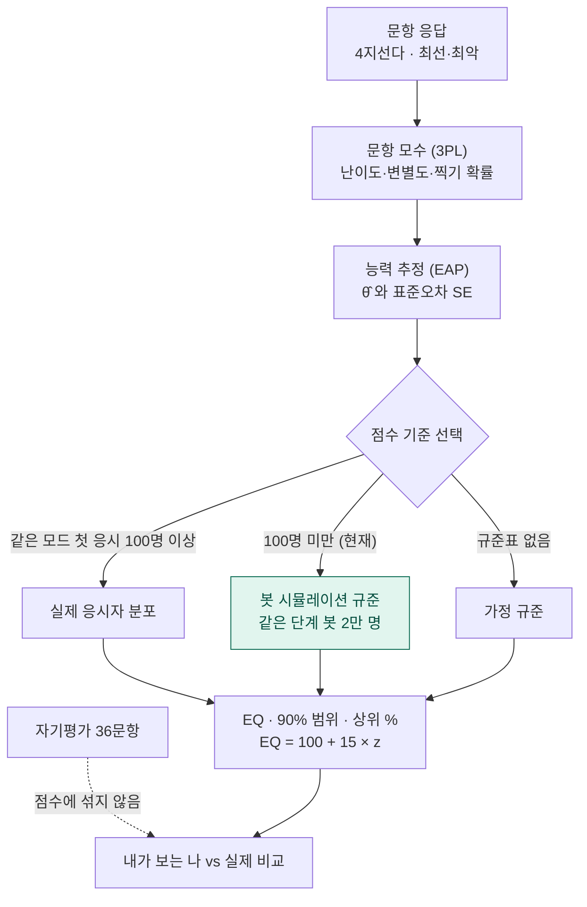
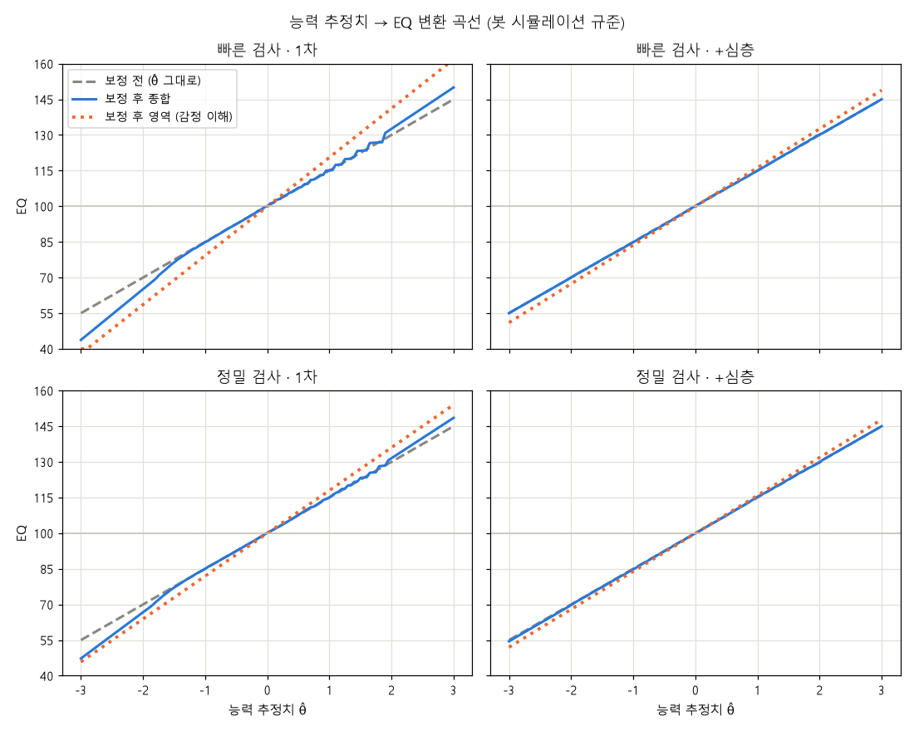

# 07. 채점 원리: 응답에서 EQ가 나오기까지

## 1. 문항 모수 (3PL)

P(θ) = c + (1 − c) / (1 + e^(−1.7·a·(θ − b)))

| 기호 | 값 |
|---|---|
| b (난이도) | 평균 능력(θ=0)에서 예상 정답률이 되도록: 쉬움 85% · 보통 65% · 어려움 45% · 매우 어려움 25% |
| a (변별도) | 1 (보정값이 있으면 그 값) |
| c (찍기) | 4지선다 0.2 · **최선·최악 1/12** (4×3=12가지 조합) |

최선·최악은 둘 다 맞아야 정답이라 찍어서 맞히기가 훨씬 어렵고, 그만큼 맞혔을 때 능력 추정에 더 큰 정보를 줍니다.

## 2. 능력 추정 (EAP)

θ를 −4~4 사이 161개 점으로 나누어 응답 패턴의 가능도와 표준정규 사전분포를 곱해 평균(θ̂)과 퍼짐(SE)을 구합니다.
종합 EQ는 8개 영역 문항을 하나의 능력으로 함께 추정합니다.

## 3. 점수 기준

- **봇 시뮬레이션 규준**: 같은 단계(1차 / 1~2차 / 1~3차 / +심층)를 마친 봇 2만 명 중 위치. 종합은 백분위(양 끝 2%는 직선 연장), 영역은 봇 분포의 평균·표준편차로 표준화.
- 결과 화면: 합산 점수는 해당 단계, 차수별 탭은 1차 기준, 심층검사 그래프는 출발 1~3차 → 이후 +심층.

## 4. 결과 표시

| 항목 | 계산 |
|---|---|
| EQ | 100 + 15 × z (40~160) |
| 90% 범위 | θ̂ ± 1.645·SE의 양 끝을 같은 기준으로 옮김 |
| 상위 % | 100 − Φ(z) × 100 |
| 수준 | 130+ 매우 우수 · 115~129 우수 · 90~114 보통 · 70~89 개발 필요 · ≤69 집중 개선 필요 |
| 강점·약점 | 영역 EQ가 본인 영역 평균보다 8점 이상, 그리고 측정 오차보다 크게 다를 때만 |

## 5. 자기평가 비교

1. 역문항은 6 − 응답으로 뒤집고 영역 평균(1~5)을 냅니다.
2. 가정 분포(평균 3.6, 표준편차 0.55)로 같은 EQ 척도로 옮깁니다: 100 + 15 × (평균 − 3.6) / 0.55.
3. 실제 EQ와 15점(1 표준편차) 넘게 차이 나면 과대평가/과소평가로 표시합니다.
4. 점검 문항 4개 중 2개 이상에 4~5점이면 "자기평가가 좋게 기울었을 수 있음"을 덧붙입니다.

## 유형은 점수와 따로

정서 유형은 정답 여부가 아니라 **어떤 보기를 골랐는지**로 정해지며, EQ 계산에는 전혀 들어가지 않습니다. 자세한 기준은 [09. 유형 판정](09_유형_판정.md).
