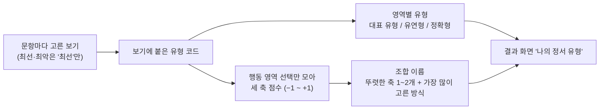

# 09. 유형 판정: 무엇을 골랐는지로 보는 나의 정서 유형

EQ가 "얼마나 잘 읽고 다루는가"라면, 유형은 "**어떤 방식으로** 다루는 편인가"입니다.
정답 여부와 상관없이 고른 보기로 정하며, **EQ 점수에는 전혀 들어가지 않습니다.** 좋은 유형·나쁜 유형은 없습니다.

## 1. 문항 작성 원칙 (유형이 의미를 가지려면)

1차 검증에서 "정답이 너무 뻔하다"는 피드백을 받고 전체 문항을 다시 썼습니다.

- **네 보기 모두 괜찮은 방법**입니다. 무례하거나 회피하는 '뻔한 오답'은 없습니다.
- 오답은 "**조금 다른 상황이었다면 정답**"인 보기입니다. 그래서 각 보기가 하나의 유형(방식)을 대표합니다.
- 상황 속 **단서 하나**가 지금의 정답을 가릅니다. 예 (대인관계·공감):

| 단서 | 정답 유형 |
|---|---|
| "그냥 들어 줘", 털어놓기만 원함 | 공감형 |
| "어떻게 하면 좋을까?" 방법을 물음 | 해결형 |
| 혼자 있고 싶다는 신호 | 존중형 |
| 솔직한 의견을 구함, 내 경계가 걸림 | 솔직형 |

다른 영역의 단서 규칙:

| 영역 | 단서 → 정답 |
|---|---|
| 감정 조절 | 내가 바꿀 수 있음→행동 · 바꿀 수 없음→관점 전환 · 감정이 너무 셈→거리 두기 · 들어 줄 사람이 있고 정리가 필요→표현 |
| 관계 갈등 | 오해이고 대화가 가능→대화 · 사과·선의가 보임→수용 · 같은 일이 반복→경계 · 직접은 막혔고 이어 줄 사람이 있음→연결 |
| 위기 대처 | 지금 바로 할 수 있음→즉시 행동 · 내 힘을 넘음→협력 · 상황이 불확실→정리 · 사람이 위험하거나 겁먹음→보호 |
| 감정 활용 | 기분이 일에 맞음→몰입 · 안 맞음→맞춤 · 되돌릴 수 없는 결정→점검 · 부정적 감정+목표→동력 |
| 해석 영역 (인식·이해·맥락) | 정답은 늘 '정확형', 오답은 읽는 방향이 다른 보기 (밝게·무겁게·겉으로·숨은 뜻을 더) |

`lint_items`가 오답 속 뻔한 말과 정답만 유난히 긴 보기를 자동으로 잡습니다 (현재 0건).

## 2. 영역별 유형

| 영역 | 유형 (축 A·B·C 방향) |
|---|---|
| 감정 인식 | 정확형 · 좋게 읽는 형 · 어둡게 읽는 형 · 겉으로 읽는 형 |
| 감정 이해 | 정확형 · 크게 읽는 형 · 가볍게 읽는 형 · 원인을 달리 보는 형 |
| 감정 활용 | 맞춤형 (−0−) · 몰입형 (+0+) · 점검형 (−0−) · 동력형 (00+) |
| 감정 조절 | 관점전환형 (00−) · 표현형 (+++) · 거리두기형 (0−−) · 행동형 (−00) |
| 대인관계·공감 | 공감형 (++0) · 해결형 (−+0) · 존중형 (0−−) · 솔직형 (0++) |
| 관계 갈등 | 대화형 (0++) · 수용형 (++−) · 경계형 (0−0) · 연결형 (−00) |
| 위기 대처 | 정리형 (−0−) · 즉시행동형 (−0+) · 협력형 (0++) · 보호형 (++0) |
| 맥락 파악 | 정확형 · 겉말형 · 의심형 · 좋게 보는 형 |

판정 기준 (`core/style.py`):

| 경우 | 결과 |
|---|---|
| 그 영역 선택이 3개 미만 | 판단 보류 |
| 행동 영역, 가장 많이 고른 유형이 40% 이상 | 그 유형 |
| 행동 영역, 어느 유형도 40% 미만 | **유연형** (상황에 따라 방법을 바꿈 — 이것도 정서 역량) |
| 해석 영역, 정확형 75% 이상 | 정확형 |
| 해석 영역, 그 밖 | 틀릴 때 가장 많이 기운 방향 (예: 좋게 읽는 형) |

## 3. 세 축과 조합 이름

행동 영역(활용·조절·대인관계·관계 갈등·위기 대처)에서 고른 보기의 축 값을 평균합니다.

| 축 | + 쪽 | − 쪽 |
|---|---|---|
| A | 감정 중심 — 마음을 먼저 살피는 | 문제 중심 — 해결을 먼저 찾는 |
| B | 다가감 — 먼저 다가가는 | 거리 둠 — 한 걸음 물러서 보는 |
| C | 표현 — 솔직하게 드러내는 | 절제 — 차분하게 다스리는 |

- 평균의 절댓값이 **0.15 이상**인 축을 '뚜렷한 축'으로 보고, 강한 순서로 최대 2개를 이름 앞에 붙입니다.
- 뒤에는 가장 많이 고른 방식(전체 행동 선택의 25% 이상일 때)을, 없으면 '유연형'을 붙입니다.
- 뚜렷한 축이 없으면 "균형 잡힌 ○○형"입니다.
- 예: "먼저 다가가는 · 마음을 먼저 살피는 공감형", "한 걸음 물러서 보는 경계형", "균형 잡힌 유연형".

MBTI처럼 16칸 중 하나로 정해지지 않고, 축 점수와 영역별 유형이 함께 나오므로 같은 이름이어도 세부 모양은 사람마다 다릅니다.
뚜렷한 축마다 반대 상황에서 놓치기 쉬운 점을 짚는 조언이 함께 나옵니다.

## 4. 결과 화면

최종 결과 탭의 **나의 정서 유형**: 조합 이름 → 세 축 막대 → 해석 경향 한 줄 → 축별 조언 → 영역별 유형 카드.
결과 카드 이미지에도 조합 이름이 들어갑니다. 빠른 검사는 영역마다 선택이 4개뿐이라 유형이 덜 정확하다는 안내가 붙습니다.

## 5. 아직 정해지지 않은 것

- 기준값(유연형 40%, 정확형 75%, 뚜렷한 축 0.15, 대표 방식 25%)은 이론적 출발점입니다. 실제 응답이 쌓이면 유형 분포가 한쪽에 몰리지 않는지 보고 조정합니다.
- 보기의 축 방향은 Claude가 정한 초안입니다. 문항 검토 때 함께 봐 주세요.
