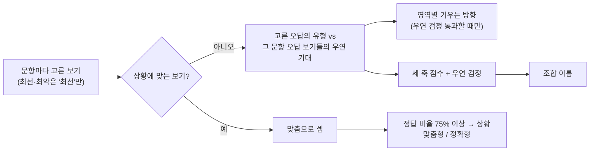

# 09. 유형 판정: 단서를 놓쳤을 때 어느 쪽으로 기우는가

EQ가 "얼마나 잘 읽고 다루는가"라면, 유형은 "**판단이 애매할 때 어떤 방식으로 기우는가**"입니다.
**EQ 점수에는 전혀 들어가지 않습니다.** 좋은 유형·나쁜 유형은 없습니다.

## 1. 문항 작성 원칙

1차 검증에서 "정답이 너무 뻔하다"는 피드백을 받고 전체 문항을 다시 썼습니다.

- **네 보기 모두 괜찮은 방법**입니다. 무례하거나 회피하는 '뻔한 오답'은 없습니다.
- 오답은 "**조금 다른 상황이었다면 정답**"인 보기이고, 보기마다 하나의 방식(유형)을 대표합니다.
- 상황 속 **단서 하나**가 지금의 정답을 가릅니다.

| 영역 | 단서 → 정답 |
|---|---|
| 대인관계·공감 | 털어놓기만 원함→공감 · 방법을 물음→해결 · 혼자 있고 싶음→존중 · 솔직한 의견을 구함·내 경계가 걸림→솔직 |
| 감정 조절 | 내가 바꿀 수 있음→행동 · 바꿀 수 없음→관점 전환 · 감정이 너무 셈→거리 두기 · 들어 줄 사람이 있고 정리가 필요→표현 |
| 관계 갈등 | 오해이고 대화가 가능→대화 · 사과·선의가 보임→수용 · 같은 일이 반복→경계 · 직접은 막혔고 이어 줄 사람이 있음→연결 |
| 위기 대처 | 지금 바로 할 수 있음→즉시 행동 · 내 힘을 넘음→협력 · 상황이 불확실→정리 · 사람이 위험하거나 겁먹음→보호 |
| 감정 활용 | 기분이 일에 맞음→몰입 · 안 맞음→맞춤 · 되돌릴 수 없는 결정→점검 · 부정적 감정+목표→동력 |
| 해석 영역 (인식·이해·맥락) | 정답은 늘 '정확형', 오답은 읽는 방향이 다른 보기 (밝게·무겁게·겉으로·숨은 뜻을 더) |

`lint_items`가 오답 속 뻔한 말과 정답만 유난히 긴 보기를 자동으로 잡습니다 (현재 0건).

## 2. 왜 '고른 것'이 아니라 '놓쳤을 때 기우는 방향'인가

처음에는 고른 보기의 유형을 그냥 셌습니다. 봇 검증(아래 4절)에서 세 가지 문제가 드러났습니다.

| 문제 | 원인 | 결과 |
|---|---|---|
| 유형이 능력을 따라감 | 정답 보기 유형이 고르지 않음 (관계 갈등: 대화형 정답 22개 · 경계형 4개, 대인관계: 솔직형 16 · 존중형 4) | 버릇이 없는 봇도 능력이 높으면 71~88%가 '솔직형'·'대화형' |
| 같은 응답인데 결과가 다름 | 동점일 때 응답 순서로 정해짐 | 순서만 섞어도 6~13% 결과가 바뀜 |
| 이름이 늘 '유연형' | 영역마다 유형 이름이 달라 25%를 넘기 어려움 | 조합 이름 끝 단어 100% 유연형 |

그래서 **상황에 맞는 보기를 고른 문항은 '맞춤'으로만 세고**, 맞지 않는 보기를 고른 문항에서
"그 문항이 내놓은 오답 보기들 가운데 무엇을 골랐나"를 우연 기대치와 비교합니다.
정답 유형의 쏠림, 한 문항에 같은 유형 보기가 둘 있는 경우(77문항)가 모두 기대치에 반영되어 상쇄됩니다.

## 3. 판정 규칙 (`core/style.py`)

### 영역별 유형
| 경우 | 결과 |
|---|---|
| 그 영역 응답이 3개 미만 | 판단 보류 |
| 상황에 맞는 보기를 75% 이상 고름 | **상황맞춤형** (해석 영역은 **정확형**) |
| 놓친 문항에서 한 유형을 우연 기대보다 뚜렷하게 많이 고름 (z ≥ 2.3, 기대의 1.5배 이상, 3번 이상) | 그 유형 (예: "단서를 놓쳤을 때 이쪽으로 기웁니다: 선을 긋고 나를 지킨다") |
| 그 밖 | **유연형** (놓쳐도 특정 방식에 치우치지 않음) |

| 영역 | 유형 (축 A·B·C 방향) |
|---|---|
| 감정 인식 | 정확형 · 좋게 읽는 형 · 어둡게 읽는 형 · 겉으로 읽는 형 |
| 감정 이해 | 정확형 · 크게 읽는 형 · 가볍게 읽는 형 · 원인을 달리 보는 형 |
| 감정 활용 | 맞춤형 (−0−) · 몰입형 (+0+) · 점검형 (−0−) · 동력형 (00+) |
| 감정 조절 | 관점전환형 (00−) · 표현형 (+++) · 거리두기형 (0−−) · 행동형 (−00) |
| 대인관계·공감 | 공감형 (++0) · 해결형 (−+0) · 존중형 (0−−) · 솔직형 (0++) |
| 관계 갈등 | 대화형 (0++) · 수용형 (++−) · 경계형 (0−0) · 연결형 (−00) |
| 위기 대처 | 정리형 (−0−) · 즉시행동형 (−0+) · 협력형 (0++) · 보호형 (++0) |
| 맥락 파악 | 정확형 · 겉말형 · 의심형 · 좋게 보는 형 |

### 세 축과 조합 이름
| 축 | + 쪽 (이름 명사) | − 쪽 (이름 명사) |
|---|---|---|
| A | 감정 중심 (마음 중심형) | 문제 중심 (해결 중심형) |
| B | 다가감 (관계 지향형) | 거리 둠 (독립형) |
| C | 표현 (표현형) | 절제 (절제형) |

- 행동 영역에서 놓친 문항마다 `c = 고른 보기의 축 − 그 문항 오답 보기들의 평균 축`.
- 축 점수(그래프) = Σc / (놓친 수 + 4), −1~1. 놓친 문항이 적으면 0 쪽으로 줄어듭니다.
- **뚜렷한 축** = 우연 검정 z = Σc / √(오답 보기 축의 분산 합) 이 ±2.3 이상이고 점수 절댓값 0.15 이상.
  버릇이 없으면 z는 표준정규분포를 따르므로 우연히 뚜렷하다고 나올 확률은 축마다 약 2%.
- **이름** = 가장 뚜렷한 축의 명사, 뚜렷한 축이 둘이면 둘째 축의 꾸밈말을 앞에.
  예: "먼저 다가가는 마음 중심형", "차분하게 다스리는 독립형", "해결 중심형".
- 뚜렷한 축이 없지만 z ≥ 1.96(우연이면 축마다 약 5%)인 축이 있으면 **"○○형 경향"** + 확신도 '약함' (예: "표현형 경향").
- 그것도 없으면: 행동 영역에서 75% 이상 맞춤 → **상황맞춤형**, 아니면 **균형형**.
- 뚜렷한 축마다 반대 상황에서 놓치기 쉬운 점을 짚는 조언이 붙습니다.

## 4. 봇 검증 (`scripts/simulate_styles.py`, 모드별 3만 명)

봇마다 **참 성향**을 심었습니다: 세 축마다 −1·0·+1, 해석 영역은 잘못 읽는 방향 하나.
봇은 3PL 확률로 단서를 읽고 정답을 고르고, 놓치면 성향대로 기웁니다(강한 성향 강도 2.0, 약한 성향 1.0, 무성향 0 각 1만 명).
실제 출제 로직으로 겹치지 않는 1·2·3차를 풀게 했습니다.

### 결과 요약 (정밀 검사)

| 확인 | 1차만 | 1~3차 합산 |
|---|---|---|
| **같은 응답 → 같은 결과** (순서를 섞어도) | 100% | 100% |
| 참 축 ↔ 추정 축 상관 (강한 성향, A/B/C) | 0.79 / 0.74 / 0.81 | 0.85 / 0.80 / 0.87 |
| **이름이 가리키는 축의 방향이 참과 맞음** | 97.7% (강) · 95.5% (약) | 98.9% (강) · 98.1% (약) |
| 성향 있는 봇에게 축 이름이 붙은 비율 | 59% (강) · 41% (약) | 87% (강) · 75% (약) |
| 무성향 봇에게 축 이름이 잘못 붙은 비율 | 3.7% | 4.9% |
| **영역 '기우는 방향'을 말했을 때 맞음** | 91 ~ 98.5% | 90.6 ~ 99.9% |
| 영역 '기우는 방향'을 말한 비율 (버릇이 있을 때) | 3 ~ 16% | 11 ~ 30% |
| 무성향인데 '기우는 방향'을 말함 | 0.6 ~ 2.3% | 0.9 ~ 2.5% |

| 재검사 (겹치지 않는 1차·2차를 따로) | 강한 성향 | 약한 성향 | 무성향 |
|---|---|---|---|
| 축 점수 상관 (A/B/C) | 0.84 / 0.83 / 0.84 | 0.72 / 0.72 / 0.73 | 0.0 (버릇이 없으니 정상) |
| 이름 완전 같음 | 50% | 49% | 79% |
| 이름의 중심 축 같음 | 64% | 60% | 92% |
| 영역 유형 같음 | 63% | 66% | 69% |

| 무성향 봇, 능력 구간 (1~3차) | 하 | 중 | 상 |
|---|---|---|---|
| 축 이름이 잘못 붙음 | 6.0% | 5.1% | 3.5% |
| 가장 흔한 이름 | 균형형 94% | 균형형 48% · 상황맞춤형 47% | 상황맞춤형 96% |

빠른 검사는 1차만으로 축 이름 정밀도 96%(강)·94%(약)이지만 이름이 붙는 비율이 33%·20%로 낮고,
영역 '기우는 방향'은 거의 나오지 않습니다(0.2 ~ 4.5%).

### 해석

- **확실한 것**: 같은 응답은 항상 같은 결과입니다. 유형이 표시되면 맞을 확률이 높습니다
  (이름 방향 96~99%, 영역 기우는 방향 91~99.9%). 버릇이 없는 사람에게 거짓 유형이 붙는 비율은 1~6%이고, 이제 능력과 무관합니다.
- **보수적으로 설계한 것**: 증거가 부족하면 이름을 붙이지 않습니다. 그래서 성향이 있어도 1차만으로는 절반 정도만 이름이 붙고,
  영역 기우는 방향은 1~3차를 합쳐도 10~30%만 표시됩니다. 많이 맞힐수록 놓친 문항이 적어 증거가 줄어듭니다.
- **재검사 이름 일치가 50% 정도인 이유**: 두 축이 비슷하게 강하면 앞뒤 순서가 회차마다 바뀌고, 이름 경계 근처에서는
  붙었다 안 붙었다 합니다. 축 점수 자체의 상관은 0.72~0.84로 안정적이므로, **이름보다 축 그래프가 더 믿을 만한 정보**입니다.
- **능력과 얽힌 것**: '상황맞춤형'은 정의상 정답을 많이 고른 사람에게 나옵니다(능력 상위 96%). 유형이라기보다
  "버릇이 드러나지 않을 만큼 상황을 잘 읽었다"는 뜻입니다.
- **축이 서로 섞이는 것**: 유형마다 여러 축을 함께 가지므로(예: 표현형 +++), 참으로는 0인 축이 다른 축에 끌려
  뚜렷하다고 나오는 경우가 있습니다(강한 성향 1~3차에서 29%). 이름의 중심 축은 대부분 맞지만 꾸밈말 축은 덜 정확합니다.
- **한계**: 봇은 이 모형(놓치면 성향대로 기운다)을 그대로 따릅니다. 실제 사람의 버릇이 이렇게 축 하나로 정리되는지는
  실제 응답이 쌓인 뒤 확인해야 합니다.

### 약한 경향 이름을 추가한 뒤 (정밀 1차, [12](12_개선_보고서.md))

| | 추가 전 | 추가 후 |
|---|---|---|
| 성향 있는 봇이 축 이름을 받음 (강 / 약) | 59 / 41% | 69 / 53% |
| 그 이름의 방향이 맞음 (강 / 약) | 97.7 / 95.5% | 96.7 / 94.3% |
| 버릇 없는 봇이 이름을 받음 | 3.7% | 10.6% (대부분 '경향 · 약함') |

정답 유형 쏠림도 40문항을 고쳐 바로잡았습니다 (관계 갈등 경계형 4 → 9, 대인관계 존중형 4 → 10, 감정 활용 몰입형 2 → 6 등).

## 5. 결과 화면

최종 결과 탭의 **나의 정서 유형**: 조합 이름 → 판정 근거(놓친 문항 수) → 세 축 막대 → 해석 경향 → 축별 조언 → 영역별 유형 카드.
결과 카드 이미지에도 조합 이름이 들어갑니다.

## 6. 아직 정해지지 않은 것

- 기준값(상황맞춤 75%, 우연 검정 z 2.3, 축 점수 0.15, 기울기 1.5배·3번)은 봇 검증으로 정한 출발점입니다.
  실제 응답이 쌓이면 유형 분포를 보고 조정합니다.
- 보기의 축 방향과, 한쪽에 쏠린 정답 유형(예: 감정 활용의 몰입형 정답 2개)은 문항 검토 때 함께 봐 주세요.
  정답 유형이 고르게 되면 '기우는 방향'을 잡을 기회가 늘어납니다.
