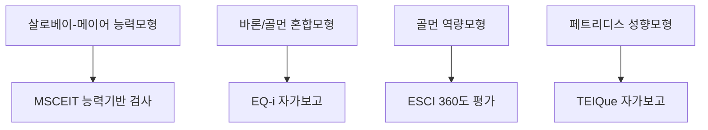
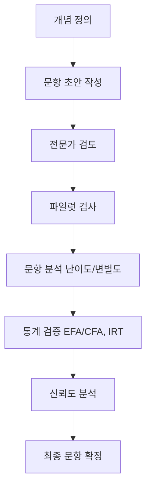

# 보고서 1 — 감성지능(EQ) 검사 개발 리포트 (사용자 제공, 정리본)

> 2026-10-11 사용자가 대화창에 붙여 넣은 보고서의 내용을 구조 그대로 정리해 보관합니다 (샘플 문항 표 등 일부는 요약). 분석과 반영 여부는 [01. 연구 정리](../../01_연구_정리.md#7-사용자가-가져온-보고서-2개)에 있습니다.
> 표의 신뢰도 수치는 보고서 스스로 "개념 예시"라고 밝힌 값이며, GECo 채점·WLEIS 설명에 사실 오류가 있습니다.

## Executive Summary

감성지능(EI 또는 EQ)은 감정 인식·이해·관리 능력과 대인관계 역량을 포함한 개인의 비인지적 자질로 정의된다. 주요 모델로는 Mayer-Salovey-Caruso의 능력모형(감정 지각·이해·활용·관리)을 비롯해 Bar-On과 Goleman의 혼합모형(감정·사회적 역량) 및 Petrides의 성향모형(자기 지각) 등이 있다. 대표적 검사 도구로는 MSCEIT(Mayer 등, 능력검사, 141문항), EQ-i(Bar-On, 자기보고식, 133문항), TEIQue(Petrides, 자기보고식, 153문항), Schutte EI(SSEIT, Schutte 등, 자기보고식, 33문항), GECo(Geneva Emotional Competence Test, 능력검사, 110문항) 등이 있다. 이들 도구는 문항 유형(문장 완성, 상황판단, 이미지판단 등)과 채점방식(자가보고 Likert, 능력정답 기반, 전문가 합의 기준)에 차이가 있으며, 신뢰도(Cronbach's α~0.7–0.9 수준)와 타당도(내용·구성·준거 검증) 지표를 갖춘다.

문항 개발 시에는 구인분석(construct analysis)을 통해 평가 범위를 명확히 하고, 전문가 검토와 파일럿 테스트를 거쳐 문항별 난이도·변별도를 확인해야 한다. 문항 유형은 자기보고(Likert 척도)·성과기반(능력검사)·상황판단(SJT) 등으로 다양하게 설계하며, 명료성, 단일성, 편향 배제 등의 가이드라인을 따른다. 예를 들어, "스트레스를 받을 때 나는 대개 (1) 휴식을 취한다 (2) 운동한다 (3) 감정을 터뜨린다 (4) 상황을 벗어난다"와 같은 상황판단형 문항을 사용할 수 있다.

검증절차는 표본 추출→파일럿 검사→문항분석→신뢰도·타당도 검증의 단계로 진행된다. 표본은 성별·연령·직업·문화적 배경을 반영하여 최소 수백명 이상 확보하며, EFA·CFA 및 IRT(문항반응이론) 등을 이용해 구성 타당성을 확인한다. 신뢰도는 내적일관성(α≥0.7) 및 재검사 신뢰도로 평가하며, 타당도는 전문가 평가(내용타당도)와 다변량 통계(CFA, 요인부하량)로 구축타당도를 검증하고, 행동 기준(성과·기존 검사)과의 상관분석으로 준거타당도를 분석한다.

점수 산출은 원점수를 합산하여 총점 및 하위요인 점수로 계산한 후, 표준점수(예: T점수, 백분위)로 변환하여 해석한다. 예를 들어 평균 50, 표준편차 10의 T점수 기준으로 40미만(백분위 16 미만)은 '낮음', 40–60(16–84)은 '보통', 60초과(84초과)는 '높음' 범주로 분류할 수 있다. 부족한 문항(결측치)은 서브스케일 평균치로 대체하거나 제외한다.

최종적으로 감성지능 검사는 개인정보 보호 및 피드백 윤리를 준수하여 사용해야 한다. 피검자는 검사 목적과 결과 처리를 이해해야 하며, 문화적 편향 검토를 통해 비서구권에서도 타당하도록 문항을 조정해야 한다. 교육·채용·임상 등 적용 분야별로 결과 활용 지침을 마련하되, 점수가 낮다고 낙인 찍지 않고 개선 교육이나 상담적 개입 기회로 연결해야 한다.

## 서론

감성지능은 타인의 감정 인식·이해·관리 능력과 자기감정 인식·조절능력을 포함하는 비인지적 지능으로, 개인의 적응성과 대인관계 능력에 중요하다. Mayer와 Salovey(1997)는 EI를 "감정을 지각·이해·관리하여 사고를 촉진하는 능력"으로 정의하며 능력 기반 검사인 MSCEIT를 개발했다. 반면 Bar-On(1997)은 EI를 "성공적 대처 능력에 영향을 미치는 개인적·정서적·사회적 역량의 집합"으로 보고 자기보고식 EQ-i 검사를 제안하였다. Goleman(1995) 또한 EI를 조직성과에 관련된 광범위한 역량으로 제시하며 360도 평가(EI Competency Inventory)를 활용했다. Petrides와 Furnham(2001)은 능력EI와 성향EI를 구분하여, 전자는 성과기반 검사를, 후자는 자가보고식을 사용하여 측정해야 한다고 주장한다.

## 방법론

원저 논문, 도구 개발자 매뉴얼, 국내외 학술지를 통해 EI 이론과 검사도구를 종합 분석하였다. 문항개발 원칙: ① 측정구인 정의에 따라 평가영역을 명확히 하고 하위역량별로 문항 뼈대를 설계한다. ② 문항은 단일개념을 묻되 선택지나 문맥은 실제 상황을 반영한다. ③ 이해하기 쉬운 한국어로 작성하며 중의성·이중부정·문화편향 표현을 제거한다. ④ 파일럿을 통해 난이도·변별도를 검토하며 문항수정과 타당도 검증을 반복한다. ⑤ 자기보고형·성과기반·상황판단형을 상황에 맞게 혼용한다.

## 결과 — 기존 도구 비교

| 도구 | 목적 | 문항 수·유형 | 채점 방식 | 신뢰도·타당도 (보고서 표기) |
|---|---|---|---|---|
| MSCEIT | 능력 모델 4영역 | 141개 (사진/시나리오 8개 Task) | 전문가·합의 기준 | α≈0.80 |
| EQ-i 2.0 | Bar-On 모델 자기보고 | 133개 (5점 Likert) | 총점 및 5개 복합척도 | α=.66–.87 |
| TEIQue | 성향 EI | 153개 (7점 Likert) | 15개 하위요인, 4개 요인, 총점 | α .85 이상 |
| SSEIT | Salovey-Mayer 모델 자기보고 | 33개 (5점 Likert) | 총점 | α≈.90 |
| GECo | 직장 맥락 능력 EI | 110개 (4개 하위검사) | 정답/오답 (보고서: 전문가 합의) | 하위검사 α .70–.85 |
| WLEIS/WEIS | 자기보고 | (보고서: 40개 강제선택) | — | — |

(신뢰도·타당도 지표는 개념 예시이며 연구마다 다를 수 있다.)

### 검증 절차

| 검증 항목 | 내용 |
|---|---|
| 문항분석 | 난이도(p), 변별도(문항총점 상관), IRT 2모수·등급반응모형 |
| 신뢰도 | Cronbach's α, KR-20, 반분 신뢰도, 재검사 신뢰도 |
| 내용타당도 | 전문가 리뷰, 편향적 표현 검토 |
| 구성타당도 | EFA → CFA, RMSEA·CFI·TLI |
| 준거타당도 | 기존 EI 검사·직무성과와의 상관 |
| 기타 | 일관성 척도·허위응답 검증, 집단 간 측정동등성 |

### 샘플 문항 (보고서 예시 20개 중 일부)

| 문항 | 측정역량 | 유형 | 채점 |
|---|---|---|---|
| "나는 긴장하거나 화가 날 때 호흡 조절 등을 통해 차분함을 유지할 수 있다." | 감정 통제 | 자기보고 | 5점 척도 |
| [이미지] 그림 속 인물의 감정 상태는 무엇일까? | 감정인식 | 수행기반 | 정답이면 1점 |
| [시나리오] 고객이 화를 내며 서비스를 요구한다. 가장 적절한 대응은? ① 경청하고 해결 ② 상급자에게 요청 ③ 상황을 피한다 ④ 사과만 한다 | 갈등관리 | 상황판단 | ① 정답 |

(나머지 17개는 대부분 "나는 ~한다" 형식의 자기보고 문항.)

### 점수 해석 (보고서 제안: T점수)

| 범주 | T점수 | 백분위 | 해석 |
|---|---|---|---|
| 낮음 | < 40 | < 16% | 평균 이하, 맞춤형 교육·상담 추천 |
| 보통 | 40–60 | 16–84% | 평균적 수준 |
| 높음 | > 60 | > 84% | 뛰어난 역량 |

## 권고안

- 심리측정 전문가와 EI 영역 전문가의 협업, 번안 시 문화권별 어휘 검토
- 최소 300명 이상 표본, α·재검사 신뢰도, EFA→CFA, IRT
- 임계값을 사전에 정의하고 목적별 해석 리포트 개발, 낙인효과 방지
- 개인정보 보호, 긍정적 강화와 개선 방향을 함께 안내, 문화적 편향 검토
- 단독 채용 도구로 사용 시 법적·윤리적 쟁점 검토
